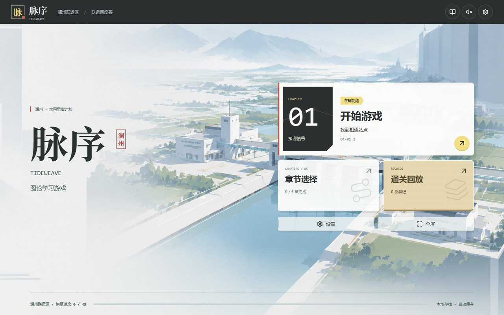
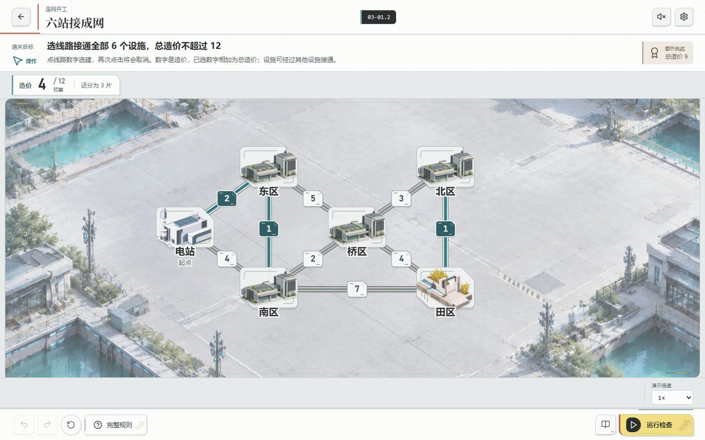
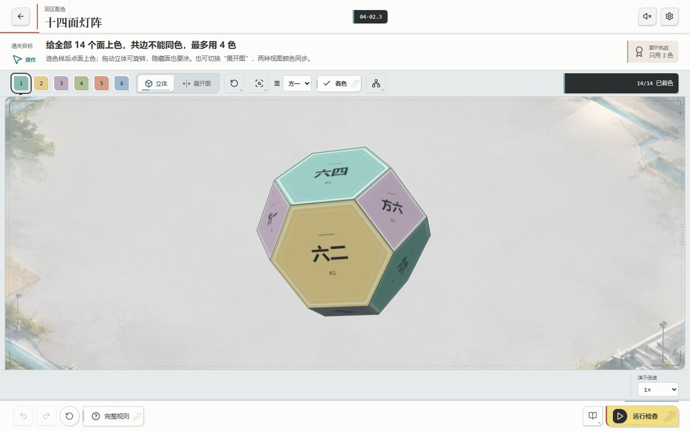

# 脉序 · Tideweave

图论学习解谜游戏：在澜州联运区修复水网、路网和电网，把数据结构教材第 7 章“图”的知识点（DFS、BFS、生成树、强连通、最短路、拓扑排序、关键路径、着色、匹配等）做成可以动手的关卡。共 5 章、20 个玩法单元、49 个小关（含主线、选修与操作过渡）。

参加「1024 学科竞赛 · Vibe Coding 创新应用大赛」的作品。

**[下载最新正式版（GitHub Releases）](https://github.com/HenryShiBinLe/Tideweave/releases/latest)** · [在线试玩](http://31.58.87.41:8080)

直接游玩请在发布页的 **Assets** 中下载对应系统的安装包或绿色版，无需安装 Node.js 或开发依赖。`Source code (zip/tar.gz)` 是开发用源码，不是可直接运行的游戏。

## 三个版本

同一份前端（`src/`），三种外壳；进度可以通过**云同步**在三者之间互通（设置 → 开启云同步，在另一台设备上输入同步码）。

| 版本 | 运行方式 | 外壳 | 下载（v0.1.0） |
|---|---|---|---|
| 网页版 | 浏览器打开 http://31.58.87.41:8080 | 无（`server/` 顺带托管网页） | — |
| Windows 版 | Windows 10/11 x64，双击安装包 | Electron（`desktop/`） | [安装包 EXE（推荐）](https://github.com/HenryShiBinLe/Tideweave/releases/download/v0.1.0/Tideweave-Setup-0.1.0.exe) · [绿色版 ZIP](https://github.com/HenryShiBinLe/Tideweave/releases/download/v0.1.0/Tideweave-Portable-0.1.0.zip) |
| Mac 版 | Apple 芯片（M1 及以后）、macOS 13+ | Swift + WKWebView（`mac/`） | [安装镜像 DMG](https://github.com/HenryShiBinLe/Tideweave/releases/download/v0.1.0/Tideweave-0.1.0.dmg) |

Windows 安装包无需管理员权限。绿色版请先解压到本地磁盘（不要放在网络共享盘），再运行文件夹里的 `Tideweave.exe`。完整安装说明与文件校验值见 [发布页](https://github.com/HenryShiBinLe/Tideweave/releases/latest)。

两个桌面版都没有商业代码签名，第一次打开时系统会拦一下：

- **Windows**：提示“Windows 已保护你的电脑”时，点“更多信息 → 仍要运行”。
- **Mac**：提示无法验证开发者时点“完成”，再到“系统设置 → 隐私与安全性”点“仍要打开”。镜像里附有《首次打开说明》。

存档都在本机，删除或重装游戏不会丢进度。Windows 版装在 `%LOCALAPPDATA%\Programs\Tideweave`，进度在其中的 `data\`；Mac 版在 App 的网页存储里。

## 游戏画面

<p align="center">
  <a href="docs/screenshots/home.jpg"></a>
  <br>
  主菜单
</p>
<p align="center">
  <a href="docs/screenshots/network.jpg"></a>
  <a href="docs/screenshots/solid.jpg"></a>
  <br>
  线路规划与立体着色 · 点击图片查看大图
</p>

## 玩法

- 章节目标在章末转场时展示：完成本章最后一个普通关后，先看本章总结，选择“前往下一章”才显示下一章目标，确认后进入关卡。浏览章节标签、直接进关或重玩都不弹出目标。
- 规划完成后运行，观察路径、传播或施工结果。可暂停、逐步、加速、跳过和返回编辑。
- 点选对象，使用撤销、重做与重置调整。不按试错、提示或旋转次数扣分。
- 基础规则随时可看。累计 3 次有效运行且尚未完美后，策略提示入口解锁，仍需主动打开。
- 完成本章全部普通关后开放本章所有选修单元，不要求徽记或后续章节成绩；单元内的小关仍按顺序开放。选修不阻塞下一章，章末可以选择继续主线或挑战本章选修。
- 完成任务后可在“筹算回放”查看过程；最短路、Prim/Kruskal、Floyd、强连通缩点和匹配增广会显示关键中间步骤；章末点明本章规律。
- 立体着色依次使用四面体操作入门、七面五棱柱、十四面截角八面体，全由 Three.js 程序生成，无模型文件。展开图按真实共享棱展开，保留配对棱号；WebGL 不可用时回退到同数据展开图。
- 部分后期配色关明确限制最多颜色数，最少色数仍作为徽记挑战。不能通过无限增加颜色绕过全部规划。
- 背景音乐和点击、通关、徽记音效全部离线，设置里可分别调节主音量、音效和音乐；窗口最小化时音乐暂停。

键盘支持 Tab/Enter/空格操作、Ctrl+Z（Mac 上 ⌘Z）撤销、Ctrl+Shift+Z 重做、1–6 色样或分组选择。立体画布使用方向键旋转，面选择菜单及“着色”按钮提供不依赖鼠标的操作。

2026-10-17 玩法修订保留 49 个关卡 ID，替换了重复地图并强化中后期规划；旧存档的兼容方式见 [docs/GAMEPLAY_CHANGES.md](docs/GAMEPLAY_CHANGES.md)。

## 开发

以下命令仅用于从源码开发或运行；直接游玩请下载上方发布包。开发需要 Node 22+，首次安装依赖需要联网，游戏本身可离线运行（云同步需联网）。

```bash
npm ci
npm test            # 规则、存档、云同步、桌面外壳等单元测试
npm run build       # 构建前端到 dist/
npm start           # 用本机 Electron 运行 Windows 版外壳（Mac 上也能跑）
npm run preview     # 本机 HTTP 预览网页版
```

各平台的打包与部署：

| 目标 | 命令 | 说明 |
|---|---|---|
| Windows 程序目录 | `npm run package` | 产物在 `release/windows/Tideweave-win32-x64/`；Mac 上也能打 |
| Windows 安装包 | 在 Windows 上用 Inno Setup 编译 `desktop/installer/Tideweave.iss` | 见 [desktop/README.md](desktop/README.md) |
| Mac App / 安装镜像 | `npm run package:mac` / `npm run dmg:mac` | 只需 Xcode 命令行工具 |
| 云同步服务 + 网页版 | `docker compose up -d`，或见 [server/README.md](server/README.md) | 根目录 `compose.yaml` 拉取镜像 `ghcr.io/henryshibinle/tideweave`，服务器上不需要源码 |

UI 验证脚本（Playwright）：`npm run verify:ui`，以及 `scripts/verify-*.mjs`。

离线标题字体已包含在 `assets/fonts/` 中，正常构建不需要原字体或 Python。只有增加标题用字、需要重新裁剪字体时，才需安装 `fonttools` 和 `brotli`，运行 `python scripts/subset-display-font.py "原始思源宋体粗体.otf的路径"` 后再 `npm run build`。

## 目录

| 路径 | 内容 |
|---|---|
| `src/` | 前端：关卡与规则（`levels.mjs`、`engine.mjs`、`algorithms.mjs`）、界面（`main.mjs`、`game.css`）、存档（`progress.mjs`）、音频（`audio.mjs`）、云同步层（`sync/`） |
| `assets/` | 素材：场景、设施、纹理、字体、音频；清单见 [docs/ASSETS_NEEDED.md](docs/ASSETS_NEEDED.md) |
| `server/` | 云同步服务端，同时托管网页版 |
| `desktop/` | Windows 版：Electron 外壳、打包脚本、安装包脚本（`installer/`）、虚拟机安装测试（`vm-test/`） |
| `mac/` | Mac 版：Swift 外壳、构建与安装镜像脚本 |
| `scripts/` | 构建、预览、UI 验证、音频制作等脚本 |
| `tests/` | 单元测试 |
| `docs/` | 文档：云同步方案与协作约定、玩法修订记录、验证记录、素材清单 |
| `archive/` | 早期原型：`test0/`（LINK · 关系实验室，纯网页）、`test1/`（图论夜校 · GraphLab，Python + PyInstaller）。保留作开发过程记录，不再维护 |

构建产物 `dist/`、`release/` 和运行时存档 `data/` 不入库。

## 说明

- 第三方组件与许可见 [THIRD_PARTY_NOTICES.md](THIRD_PARTY_NOTICES.md)。
- 自动测试不等于游戏体验已经达到成品质量。还应继续做新玩家难度试玩、最终美术替换和跨电脑兼容验证；回放是可玩的过程说明，不等于完整的算法课程或代码级演示。
